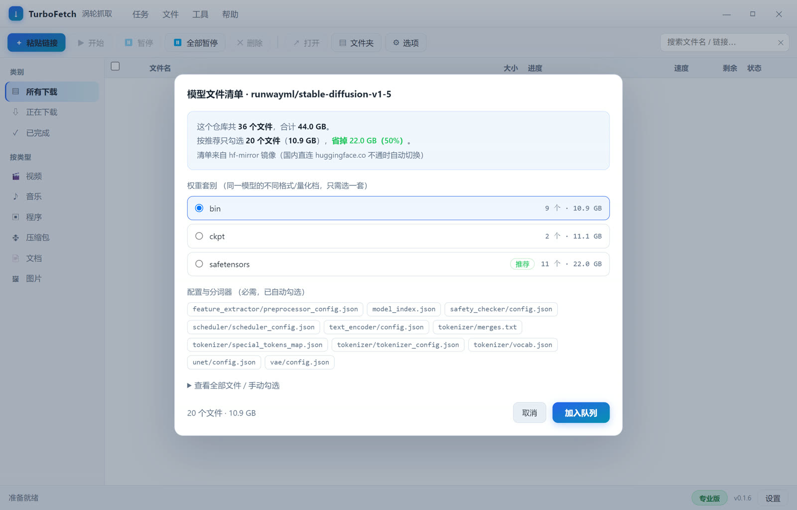

# TurboFetch 涡轮抓取（Windows 图形界面版）

> **先说清楚，避免混淆**：GitHub 上有好几个同名项目 ——
> 一个 Rust 写的命令行工具、一个 cmake 代码片段、一个 Linux CLI。
> **本仓库是另一回事**：Windows 上的图形界面下载器，官网 [turbofetch.cn](https://turbofetch.cn)，
> 商店里那个同名 App 也和我们无关。
>
> 本仓库用于**发布说明、问题反馈和版本记录**，不包含源码（商业软件）。

---

## 它解决什么问题

### 一、下 HuggingFace 模型时，不知道下哪个文件

一个模型仓库点开，几十个文件混在一起：`bin`、`safetensors`、`ckpt`、`fp16`、还有 diffusers 的整套目录。
新手第一反应是全下 —— 44 GB 下完，发现只用得上其中一个 4 GB 的。

TurboFetch 的做法：粘仓库地址，它把**完整文件清单**拉下来，按格式分组、标出每组多大、自动勾上配置和分词器，
你只需要点一套。



以 `stable-diffusion-v1-5/stable-diffusion-v1-5` 为例：
**36 个文件 / 44.01 GB → 实际只需要下 10.9 GB，省掉 22 GB。**

> 不想装软件也想看清单？用免费在线工具：<https://turbofetch.cn/tools/hf>

### 二、浏览器下大文件，断了就从头来

20 GB 的文件用浏览器单线程下，中间断一次就得重来。TurboFetch 把文件切成多段同时拉，
断了从断点接着走，默认 64 线程（可调）。

### 三、下完不知道对不对

HuggingFace 上的 LFS 文件带 sha256。TurboFetch 下完自动校验，缺哪个文件直接告诉你，
而不是等 ComfyUI 加载报 `unexpected key` 再回头猜。

### 四、视频也能下

粘 B站 / YouTube / TikTok / 抖音的页面地址，自动解析清晰度、音视频合流。

抖音支持这几种地址形式（实测都通）：

```
https://www.douyin.com/video/<id>
https://www.douyin.com/vs?modal_id=<id>
https://www.douyin.com/jingxuan?modal_id=<id>
https://www.douyin.com/user/<uid>?modal_id=<id>
https://v.douyin.com/<code>/          （App 分享的短链）
整段分享文字                          （自动抽出里面的链接）
```

> 抖音的画面和声音是分开的两条流，而且它要求「在页面上下文里请求」才给直链。
> 所以应用内会开一个隐藏窗口在页面里取地址 —— 这也是为什么它不需要你配 cookies。

---

## 下载

**<https://turbofetch.cn/download>**

- Windows 10 / 11 · 64 位
- 安装版 / 免安装便携版
- 3 天全功能试用，之后买断（¥69 个人版 1 台 / ¥129 三机版 3 台），不是订阅

> 安装包**没有做代码签名**，第一次运行 Windows 会提示「已保护你的电脑」。
> 点「更多信息」→「仍要运行」。介意的话请勿安装。

---

## 其他功能

- **浏览器扩展**：在视频页面上一键把地址发给应用（扩展在 [Releases](../../releases) 里）
- **多语言**：简体中文 / 繁體中文 / English
- **不限同时任务数**
- **分类归档**：按视频/音乐/程序/压缩包/文档/图片自动分子目录（可关）
- **剪贴板监听**：复制链接自动弹新建任务（可关）
- **下载完成后自动执行**：关机 / 休眠 / 打开文件（可关）

---

## 常见问题

**Q：和 IDM / 迅雷有什么区别？**
A：不做什么都能下。就针对一件事：下模型的时候别让我一个个判断、一个个点。
列清单、选套别、只下要的、下完校验。

**Q：需要登录 / 上传数据吗？**
A：不需要。程序只把「机器指纹的 SHA-256 + 版本号」发给授权服务器用于试用计时，
不上传文件名、下载内容、浏览记录，也没有任何统计/遥测。详见[隐私政策](https://turbofetch.cn/privacy)。

**Q：抖音解析不出来？**
A：先确认是 0.2.1 或更新版本。抖音的地址形式比较多，见上面列的五种。
如果还不行，把链接贴到 [Issues](../../issues)，我来看。

**Q：下载速度慢？**
A：先换个时段试（香港服务器的线路波动很大），或者在设置里把「网络代理」改成手动指定。
如果是抖音下载慢，试试把线程数从 64 降到 16。

---

## 反馈

- 问题 / 建议：[Issues](../../issues)
- 邮箱：turbofetch@outlook.com
- QQ 群：462036111

---

## 变更记录

### 0.2.2
- 修复：解析抖音时页面里的 `bytedance://` 深链会让 Windows 弹
  「没有可打开此链接的应用，请去 Microsoft Store 查找」—— 现在应用内会拦掉所有非 http(s) 跳转
- 增加全局协议白名单：主窗口同样不会再触发系统协议提示

### 0.2.1
- 抖音：支持 `/jingxuan?modal_id=`、`/vs?modal_id=`、短链和整段分享文字
- 抖音：改为在隐藏窗口里取直链（不再需要用户配 cookies）
- 已知视频站不再弹「这个地址看起来是网页」的确认框
- 修复：池码发货时未按档位优先、限期码被永久订单取用的问题

### 0.2.0
- 抖音：应用内粘贴 → 隐藏窗口解析 → 多线程下载
- 修复：内容脚本在隔离世界请求抖音接口被 403

### 0.1.9
- 抖音：先打开视频页再取直链（未打开时接口返回 403）

### 0.1.7 / 0.1.8
- 新增「一键获取 cookies」：应用内开登录窗口，自动保存 cookies.txt
- 下载页增加文件名丢失的兜底说明

---

## 商标说明

本仓库与以下同名项目**没有关系**：

- `ynyg-shared/turbofetch` — Rust 命令行下载器
- `Heerdam/TurboFetch` — CMake 代码片段
- `ajTronic/turbofetch` — Linux CLI
- Microsoft Store 上的同名下载管理器
- Firefox 扩展商店的同名扩展
